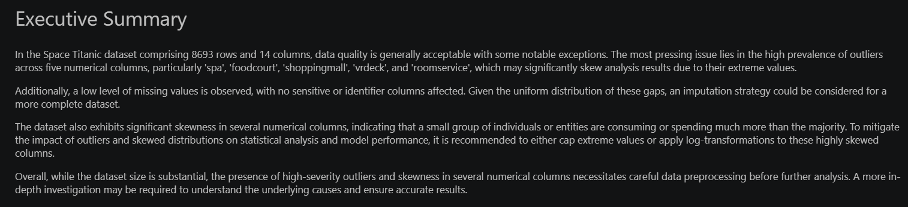
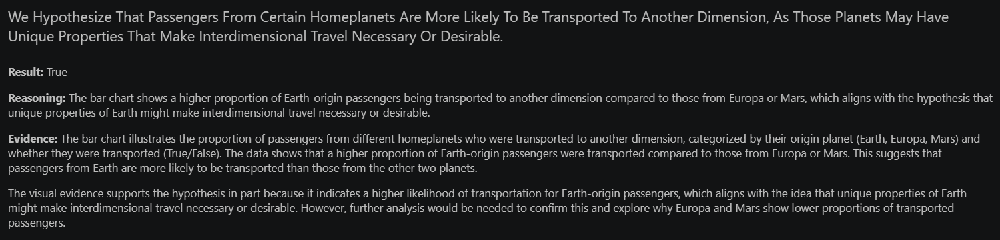
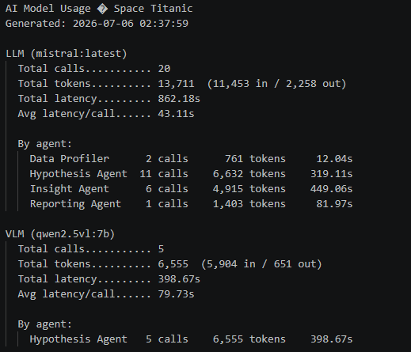
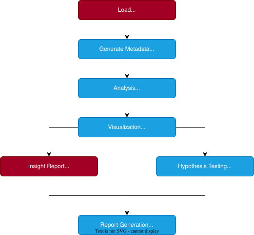

# AI Data Analyst Agent

An AI-powered data analysis workflow that automatically profiles CSV datasets, performs exploratory data analysis (EDA), generates visualizations, and interprets statistical findings using local Large Language Models (LLMs) and Vision Language Models (VLMs), producing professional Markdown and Jupyter Notebook reports with no external API calls.


## Table of Contents
- [Highlights](#highlights)
- [Demo](#demo)
- [Features](#features)
- [Architecture](#architecture)
- [Tech Stack](#tech-stack)
- [Folder Structure](#folder-structure)
- [AI Model Statistics](#ai-model-statistics)
- [Installation](#installation)
- [Usage](#usage)
- [Future Work](#future-work)
- [License](#license)
- [Author](#author)

## Highlights

- Automatic dataset profiling and exploratory data analysis
- Deterministic statistical analysis and visualization generation
- LLM-powered insight generation and executive summaries
- Vision-language model (VLM) interpretation of charts
- Automated hypothesis generation and validation
- Exportable Markdown and Jupyter Notebook reports
- LangGraph orchestration with modular AI agents
- Built-in token usage and latency monitoring for every AI model

## Demo

### Executive summary and insights


### Hypothesis testing with chart validation



### AI model usage statistics


A complete example run is available in [`output_example/`](output_example/), generated from the [Spaceship Titanic](https://www.kaggle.com/competitions/spaceship-titanic) dataset:

- [Generated report (Markdown)](output_example/space_titanic_report.md)
- [Generated notebook](output_example/space_titanic_report.ipynb)
- [AI model usage statistics](output_example/space_titanic_model_stats.txt)

## Features

- **Automated dataset profiling** - extracts dataset metadata, detects numerical/categorical feature types, and identifies sensitive and identifier columns using LLM-assisted classification.

- **Exploratory data analysis (EDA)** - performs descriptive statistics, missing value analysis, outlier detection, correlation analysis, and class imbalance assessment.

- **Automatic visualization generation** - creates charts including histograms, box plots, bar charts, heatmaps, and target-wise visualizations.

- **LLM-powered insights** - converts statistical outputs into concise, human-readable insights and executive summaries using large language models.

- **Vision-based chart interpretation** - uses vision language models (VLMs) to analyze generated charts and validate analytical hypotheses.

- **Automated hypothesis generation and validation** - generates analytical hypotheses, selects suitable visualizations, and evaluates supporting evidence over multiple rounds.

- **LangGraph workflow orchestration** - coordinates deterministic analysis components and AI agents through a modular, stateful pipeline.

- **Professional report generation** - exports complete analysis reports in both Markdown and Jupyter Notebook formats with embedded visualizations.

- **AI model telemetry** - tracks token usage, latency, and per-agent call statistics for every report generation run.


## Architecture
AI Data Analyst is orchestrated as a LangGraph pipeline. Each node reads from a shared AnalysisState (a `TypedDict`) and returns only the state keys it produces. Nodes never mutate or return the full state, which keeps the graph safe under LangGraph's fan-out/fan-in semantics.



Pipeline stages:
1. Load - reads the input CSV and column descriptions file into state.
2. Generate Metadata - classifies columns as numerical or categorical, and uses LLM calls (with column names and descriptions as context) to detect sensitive/PII columns and identifier columns, excluding both from downstream analysis.
3. Analysis - runs deterministic profiling: missing values, outliers, correlations, class balance, and numerical/categorical summaries.
4. Visualization - generates deterministic charts from the analysis output.
5. Insight Report and Hypothesis Testing run in parallel, both consuming the same upstream state:
- Insight Report summarizes the deterministic analysis into a written narrative using a local text LLM.
- Hypothesis Testing runs a fixed number of rounds, each generating candidate hypotheses, building chart specs, rendering charts, and validating them against the rendered charts using a local vision LLM. Results accumulate across rounds.
6. Report Generation - assembles the final Markdown and Jupyter notebook report from all upstream state.

All models run locally (Mistral:latest for text, Qwen2.5-VL:7B for vision). No external API calls are made during analysis.

> **Design Philosophy**
>
> Objective statistical computations such as profiling, EDA, and visualization are performed deterministically for reliability and reproducibility. Large Language Models are used only for tasks requiring reasoning, interpretation, hypothesis generation, and report writing.

## Tech Stack

| Category | Technologies |
|----------|--------------|
| **Language** | Python |
| **Orchestration** | LangChain, LangGraph |
| **Model Serving** | Ollama |
| **Models** | Mistral:latest (Text), Qwen2.5-VL:7B (Vision) |
| **Data Analysis** | Pandas, NumPy |
| **Visualization** | Matplotlib, Seaborn |
| **Structured Output Validation** | Pydantic |
| **Reporting** | Jupyter Notebook, Markdown |
| **Version Control** | Git |

## Folder Structure
```
AI-Data-Analyst/
│
├── agents/
│   ├── hypothesis_agent.py
│   ├── insight_agent.py
│   └── reporting_agent.py
│
├── orchestration/
│   ├── nodes.py
│   ├── run.py
│   └── workflow.py
│
├── services/
│   ├── chart_generator.py
│   ├── dataset_service.py
│   └── models.py
│
├── tools/
│   ├── analysis_tools.py
│   ├── notebook_tools.py
│   ├── profiling_tools.py
│   ├── report_tools.py
│   ├── telemetry_tools.py
│   └── visualization_tools.py
│
├── config/
├── data/
├── docs/
├── output_example/
├── outputs/
├── prompts/
├── schemas/
├── tests/
│
├── LICENSE
├── main.py
├── pyproject.toml
└── README.md
```

> **Note:** Some folders shown above (e.g. `data/`, `outputs/`) may be empty or excluded from version control via `.gitignore`. They represent expected structure, not necessarily committed contents.

## AI Model Statistics

Every run generates a plain-text usage summary alongside the report, showing token usage, call counts, and latency for each AI model, broken down by the agent that invoked it.

**Example output (`Space_Titanic_model_stats.txt`):**

```
AI Model Usage - Space Titanic
Generated: 2026-07-06 17:53:23

LLM (mistral:latest)
  Total calls........... 20
  Total tokens.......... 13,632  (11,544 in / 2,088 out)
  Total latency......... 275.67s
  Avg latency/call...... 13.78s

  By agent:
    Data Profiler      2 calls      761 tokens      9.68s
    Hypothesis Agent  11 calls    6,740 tokens    101.07s
    Insight Agent      6 calls    4,831 tokens    156.64s
    Reporting Agent    1 calls    1,300 tokens      8.28s

VLM (qwen2.5vl:7b)
  Total calls........... 5
  Total tokens.......... 6,664  (5,901 in / 763 out)
  Total latency......... 225.74s
  Avg latency/call...... 45.15s

  By agent:
    Hypothesis Agent   5 calls    6,664 tokens    225.74s
```

## Installation

**Prerequisites:**
- Python 3.10+
- [Ollama](https://ollama.com) installed and running locally

**1. Clone the repository**

```bash
git clone https://github.com/gaurav-S8/ai-data-analyst.git
cd ai-data-analyst
```

**2. Install dependencies**

```bash
pip install -e .
```

**3. Pull the required local models via Ollama**

```bash
ollama pull mistral
ollama pull qwen2.5vl:7b
```

## Usage

Run the pipeline from the command line, pointing it at your dataset and a JSON file describing each column:

```bash
python main.py \
  --dataset-path data/my_dataset.csv \
  --column-descriptions data/my_dataset_columns.json \
  --target-column target \
  --dataset-name "My Dataset" \
  --output-folder outputs/
```

**Example `column_descriptions.json`:**

Descriptions are optional per column, i.e. any column without an entry falls back to name-based classification.

```json
{
  "Age": "Passenger age in years",
  "Fare": "Ticket price paid in USD",
  "Cabin": "Cabin number, deck/room/side format"
}
```

**Arguments:**

| Argument | Required | Description |
|---|---|---|
| `--dataset-path` | Yes | Path to the input dataset (CSV). |
| `--column-descriptions` | Yes | Path to a JSON file describing each column. |
| `--target-column` | Yes | Name of the target column. |
| `--dataset-name` | Yes | Display name for the dataset, used in the report. |
| `--output-folder` | Yes | Directory where the generated report will be saved. |

On completion, the pipeline prints the path to the generated report:

```
Report saved to: outputs/my_dataset_report.md
```

## Future Work

The current implementation focuses on automated exploratory data analysis and report generation. Potential future enhancements include:

- **Dynamic Workflow Routing** – Extend the LangGraph workflow with conditional routing so agents can decide which analyses and visualizations to execute based on dataset characteristics.

- **Adaptive Hypothesis Generation** – Replace the current fixed-round hypothesis loop with a stopping condition based on hypothesis quality, and prune weak hypotheses across rounds instead of accumulating all of them.

- **Automated Machine Learning (AutoML)** – Expand the workflow to perform feature engineering, model training, evaluation, and comparison, transforming the system from an AI Data Analyst into an AI Data Scientist.

- **Interactive Dashboard** – Develop a Streamlit-based interface for dataset upload, analysis configuration, and interactive report visualization.

## License

This project is licensed under the MIT License. See the [LICENSE](LICENSE) file for details.

## Author

**Gaurav Singariya**

- Email: gaurav.singariya.26@gmail.com
- LinkedIn: [linkedin.com/in/gauravsingariya](https://www.linkedin.com/in/gauravsingariya/)
- GitHub: [github.com/gaurav-S8](https://github.com/gaurav-S8)