# AI Data Analyst Report


**Dataset:** Space Titanic

**Generated:** 2026-07-06 18:10

**Rows:** 8693 | **Columns:** 14

---

## Executive Summary
 In the Space Titanic dataset comprising 8693 rows and 14 columns, data quality is generally satisfactory with only minor issues. The most pressing concern involves a significant number of outliers across six numerical columns, particularly in age, roomservice, foodcourt, vrdeck, shoppingmall, and spa, which may distort statistical analyses due to extreme values.

Additionally, the dataset exhibits a low level of missing values, with no sensitive or identifier columns affected. The uniform distribution of these gaps suggests a common cause, making an imputation strategy a potential solution for filling in the data gaps.

The target column 'transported' shows a balanced distribution, ensuring fair model training. However, it is essential to distinguish between true and natural outliers in the heavily skewed numerical columns, as their presence may indicate data entry mistakes or anomalies that could impact analysis integrity.

To maintain the dataset's quality and mitigate potential distortions caused by outliers and high skewness, it is recommended to either cap these values, log-transform the data, or investigate further to ensure accurate data representation. A comprehensive examination of the data will be presented in the following report sections.

---

## 1. Missing Values
The Space Titanic dataset exhibits a low level of missing values across its 14 columns, with a maximum missing percentage of 2.5%. The missingness is relatively uniform across the columns, suggesting that there may be a common cause for the data gaps. However, it's worth noting that no sensitive or identifier columns (passengerid and name) have missing values. Given the low severity and uniform distribution of missing values, an imputation strategy could be considered to fill in the gaps, ensuring a more complete dataset for analysis.

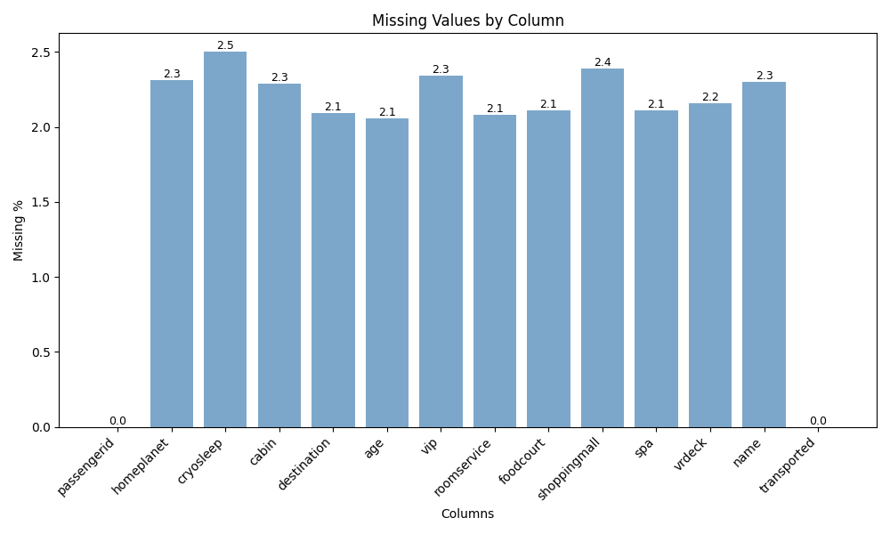

---

## 2. Outliers
The data quality report reveals a significant number of high severity outliers across six numerical columns, indicating the presence of extreme values that deviate significantly from the rest of the dataset. Specifically, five columns - age, roomservice, foodcourt, vrdeck, shoppingmall, and spa - exhibit high outlier percentages ranging from 21.01% to 21.86%. This suggests a pattern of heavy spending in these categories by a small group of individuals rather than data errors. It is essential to distinguish between true outliers, which may indicate data entry mistakes or anomalies, and natural outliers, which represent valid extreme values. Given the high outlier percentages, it would be prudent to either cap these values, log-transform the data, or investigate further to ensure the accuracy of the data and maintain the integrity of the analysis.

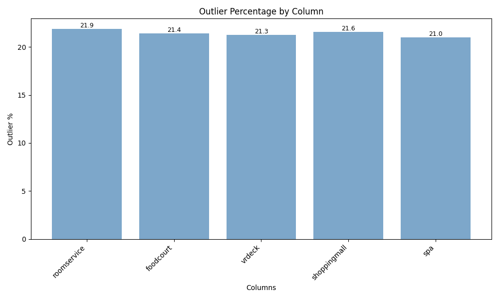

---

## 3. Distributions
The data analysis reveals a significant skewness in several numerical columns, indicating that the distribution of values is heavily concentrated towards one side. Specifically, columns such as roomservice, foodcourt, vrdeck, shoppingmall, and spa exhibit highly right-skewed distributions, with mean values significantly higher than their respective medians. This suggests that a small group of individuals or entities are spending substantially more in these areas compared to the majority. Conversely, the 'age' column shows an approximately symmetric distribution, implying a relatively even spread of ages among the data population. It is noteworthy that all columns have a minimum value of 0, which may indicate that these variables only capture positive values or are subject to zero inflation. The presence of high skewness and a considerable number of outliers in our dataset (6 total outliers with 5 of high severity) tells the same story: the data is heavily influenced by a few extreme values, which may distort statistical analyses and require attention. To mitigate this issue, it is recommended to either log-transform these highly skewed columns or standardize them to bring the data closer to a normal distribution.

**BOX_ROOMSERVICE**

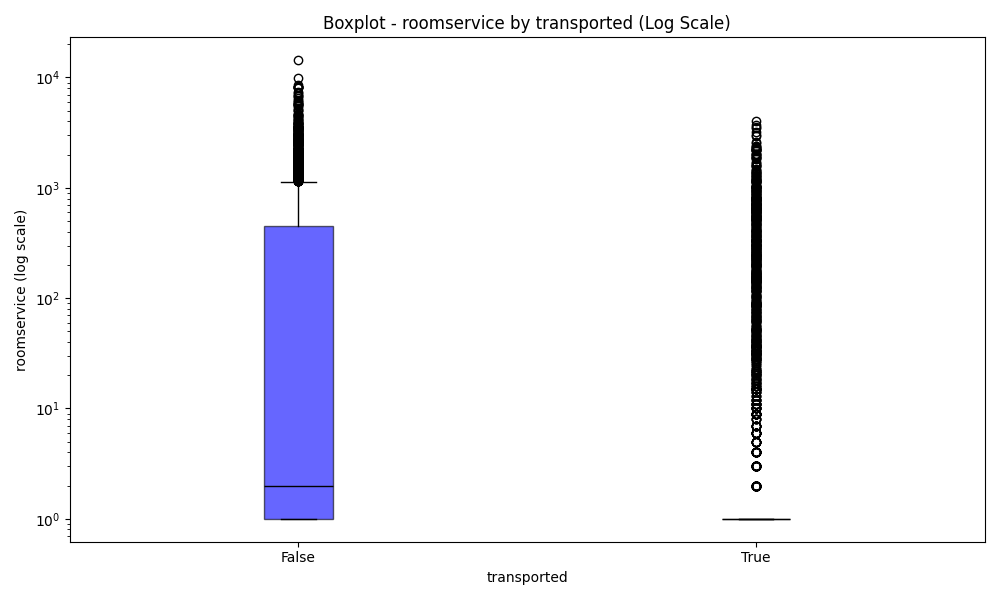

**BOX_FOODCOURT**

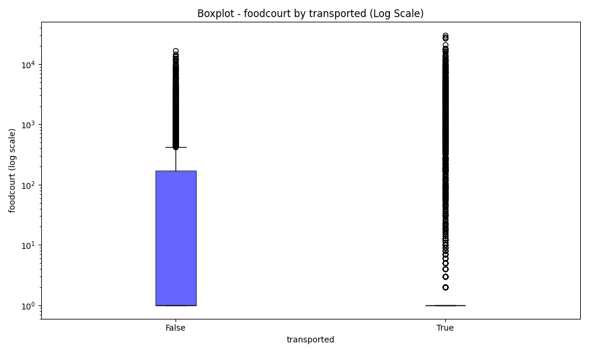

**BOX_VRDECK**

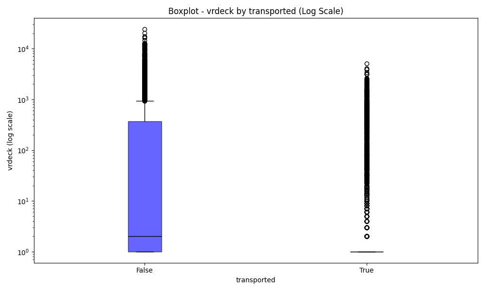

**BOX_SHOPPINGMALL**

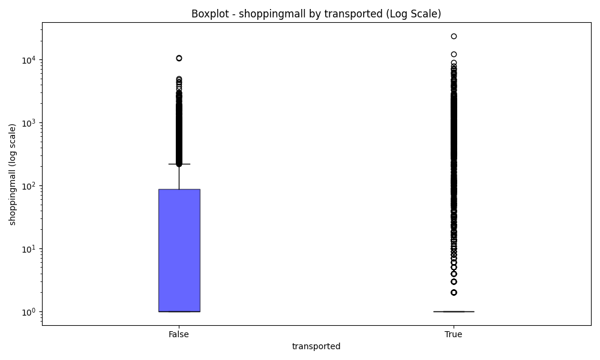

**BOX_SPA**

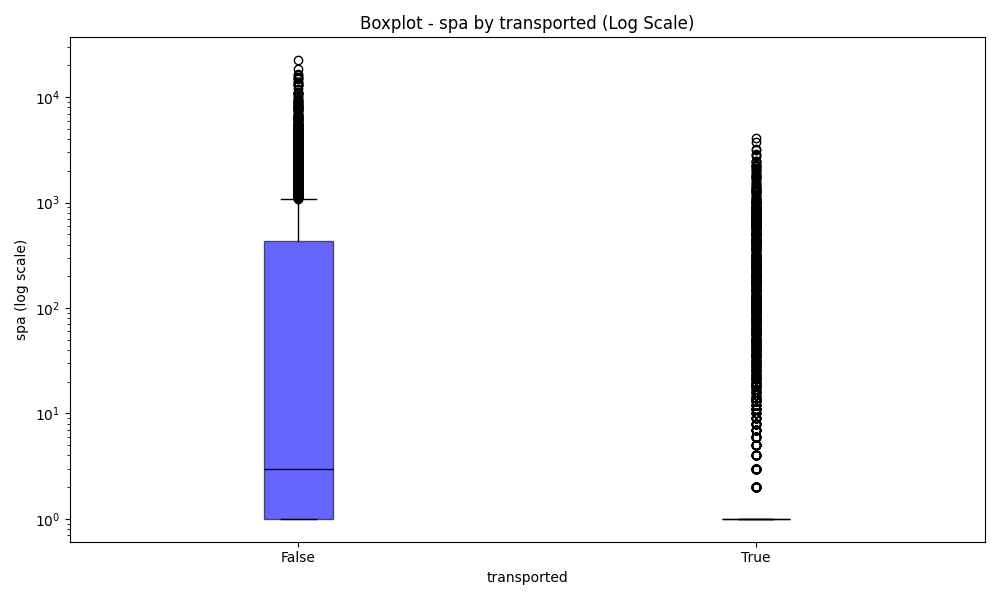

**HIST_AGE**

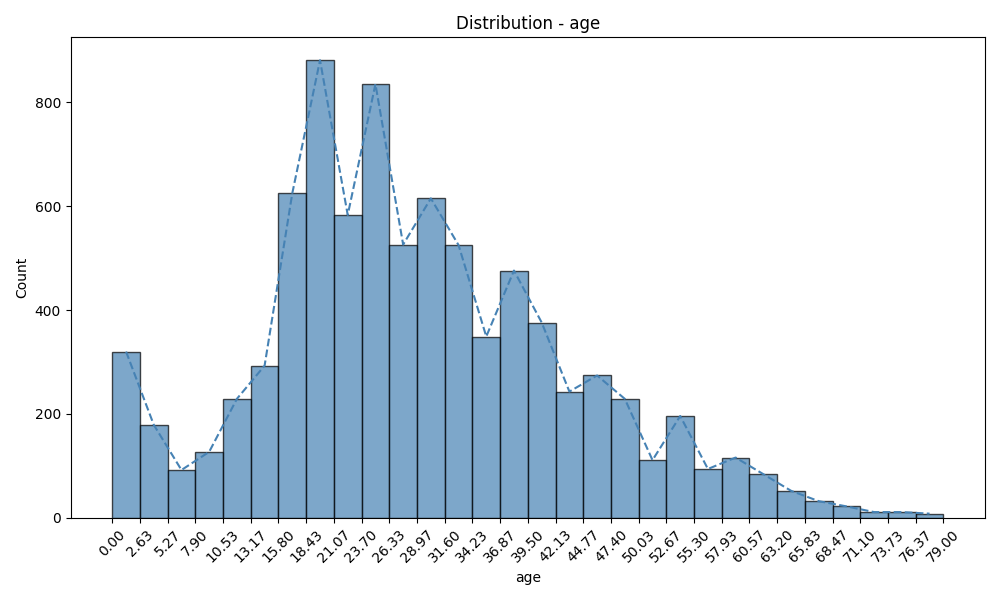

**HIST_ROOMSERVICE**

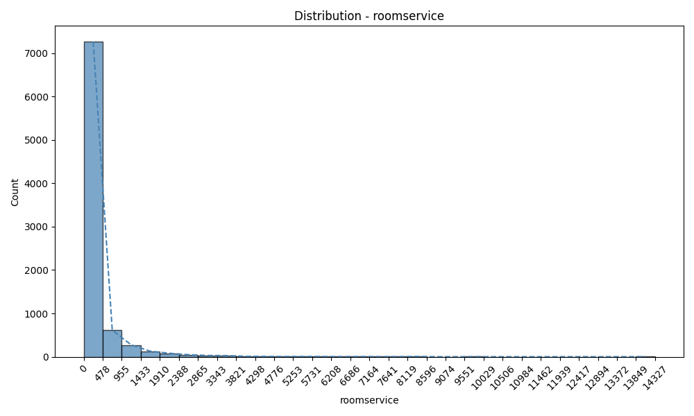

**HIST_FOODCOURT**

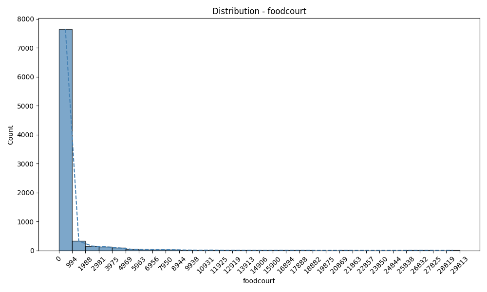

**HIST_VRDECK**


**HIST_SHOPPINGMALL**

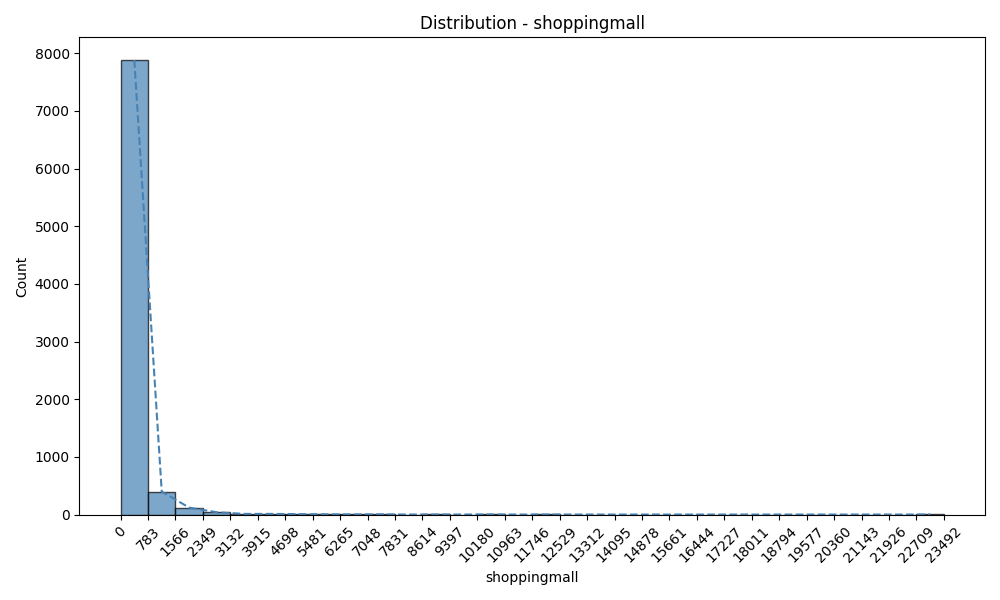

**HIST_SPA**

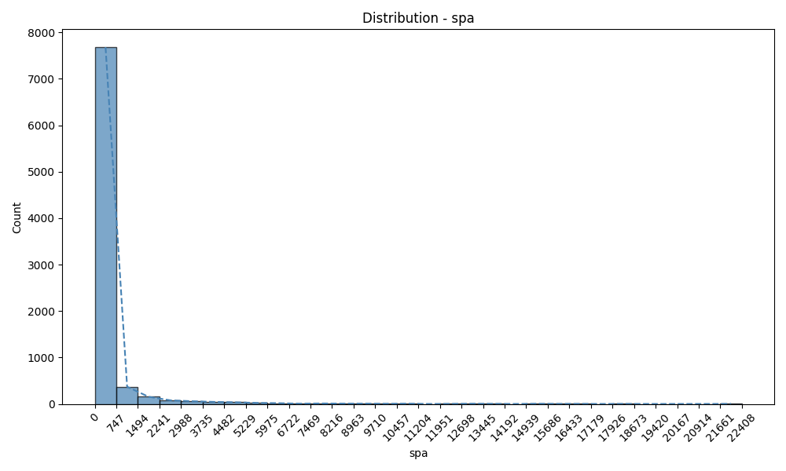


---

## 4. Correlations
In this analysis, there are no strong correlations present among the numerical columns of age, roomservice, foodcourt, vrdeck, shoppingmall, and spa, as the total number of strong pairs is zero. However, some notable correlations were identified that may provide insights into customer behavior within the data set. For instance, a positive correlation exists between age and the usage of foodcourt, vrdeck, and spa facilities, suggesting that older guests tend to utilize these amenities more frequently. Similarly, there is a strong relationship between foodcourt and vrdeck usage, as well as between foodcourt and spa usage, indicating that guests who frequent one of these areas are likely to also visit the other. Lastly, a moderate correlation was found between vrdeck and spa usage, suggesting that guests who engage in virtual reality activities may also be more inclined to relax at the spa. Overall, the absence of strong correlations is a positive finding, implying that each feature carries independent information.

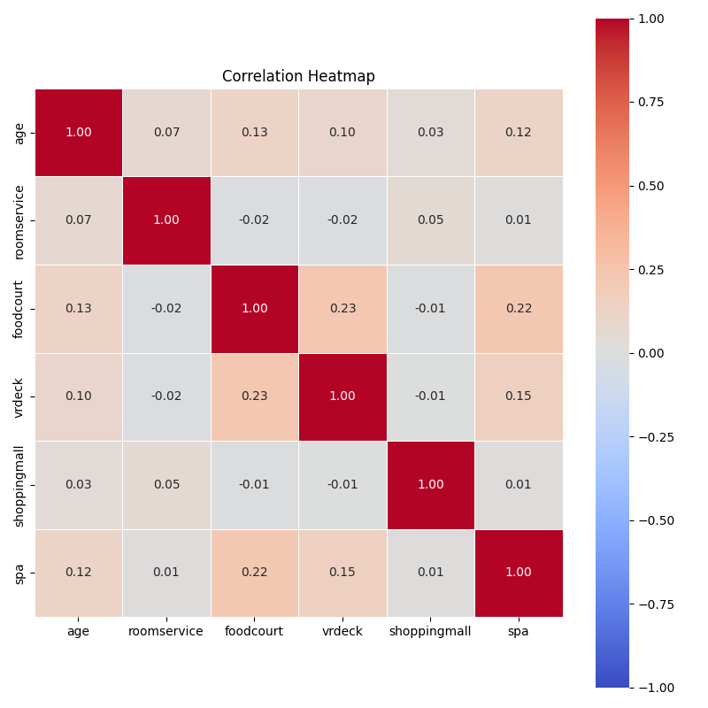

---

## 5. Categorical Features
The dataset contains a total of 5 categorical columns, with one high cardinality column, 'cabin', which has an unusually large number of unique values (6560). High cardinality columns like this require special handling methods such as target encoding to prevent issues during machine learning model training. Two binary columns, 'vip' and 'cryosleep', are present in the dataset. The 'vip' column is heavily imbalanced with 97.7% of passengers being non-VIP. On the other hand, the 'cryosleep' column shows a more balanced distribution, with approximately 64.2% of passengers not using cryosleep and 35.8% using it. The 'destination', 'homeplanet', and 'destination' columns provide insights into the origins and destinations of the passengers, with Earth being the most common home planet (54.2%) and destination (69.5%).

**BAR_DESTINATION**

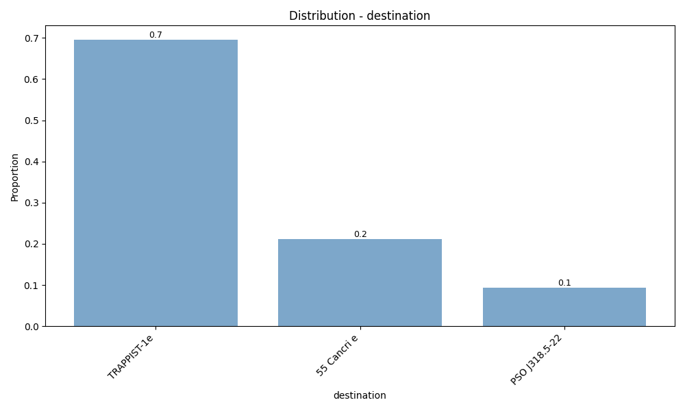

**BAR_VIP**

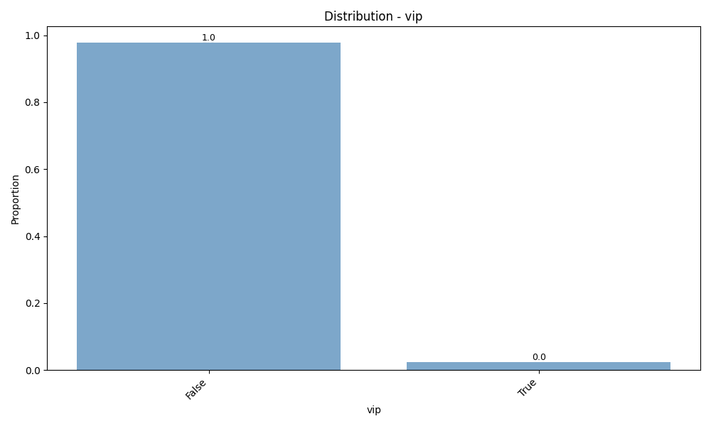

**BAR_HOMEPLANET**

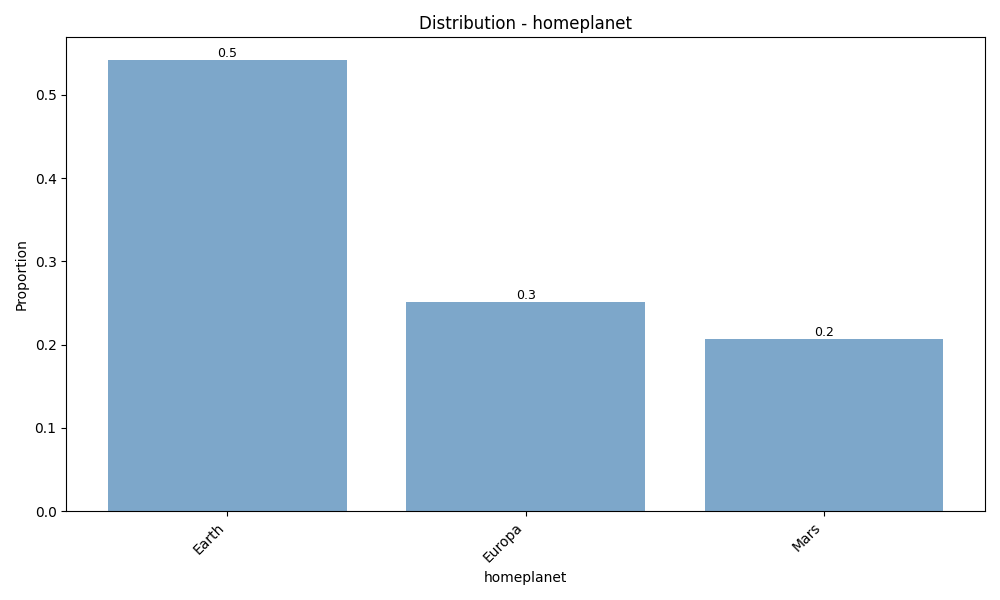

**BAR_CRYOSLEEP**

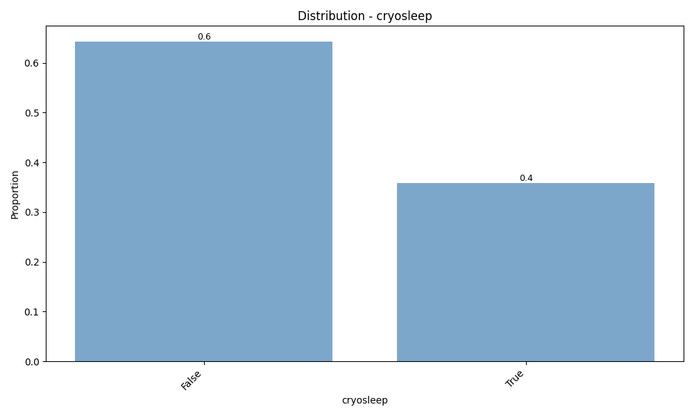


---

## 6. Class Balance
The target column 'transported' in the dataset exhibits a balanced distribution with 50.4% instances labeled as 'True' and 49.6% as 'False'. Given the normal imbalance severity, no resampling or class weighting is required at this time to ensure fair model training.

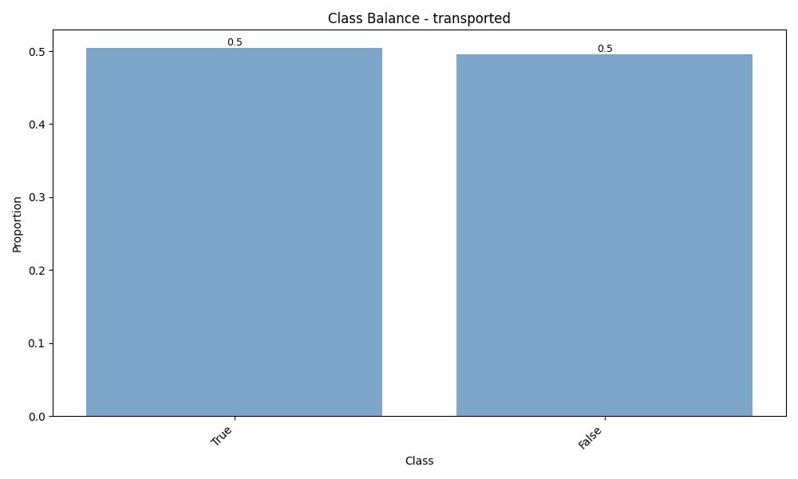

---

## Appendix — Dataset Profile
```json
{
  "number_of_rows": 8693,
  "number_of_columns": 14,
  "columns": [
    "passengerid",
    "homeplanet",
    "cryosleep",
    "cabin",
    "destination",
    "age",
    "vip",
    "roomservice",
    "foodcourt",
    "shoppingmall",
    "spa",
    "vrdeck",
    "name",
    "transported"
  ],
  "features": {
    "numerical_columns": [
      "age",
      "roomservice",
      "foodcourt",
      "vrdeck",
      "shoppingmall",
      "spa"
    ],
    "categorical_columns": [
      "destination",
      "vip",
      "homeplanet",
      "cryosleep",
      "cabin"
    ],
    "column_dtypes": {
      "passengerid": "object",
      "homeplanet": "object",
      "cryosleep": "object",
      "cabin": "object",
      "destination": "object",
      "age": "float64",
      "vip": "object",
      "roomservice": "float64",
      "foodcourt": "float64",
      "shoppingmall": "float64",
      "spa": "float64",
      "vrdeck": "float64",
      "name": "object",
      "transported": "bool"
    },
    "missing_values_percentages": {
      "passengerid": 0.0,
      "homeplanet": 2.31,
      "cryosleep": 2.5,
      "cabin": 2.29,
      "destination": 2.09,
      "age": 2.06,
      "vip": 2.34,
      "roomservice": 2.08,
      "foodcourt": 2.11,
      "shoppingmall": 2.39,
      "spa": 2.11,
      "vrdeck": 2.16,
      "name": 2.3,
      "transported": 0.0
    }
  },
  "number_of_duplicate_rows": 0,
  "target_column": "transported",
  "target_column_dtype": "bool",
  "target_column_summary": {
    "number_of_unique_values": 2,
    "value_distribution": {
      "True": 0.504,
      "False": 0.496
    }
  },
  "dataset_name": "Space Titanic",
  "sensitive_columns": [
    "name",
    "passportid"
  ],
  "identifier_columns": [
    "passengerid",
    "name"
  ]
}
```